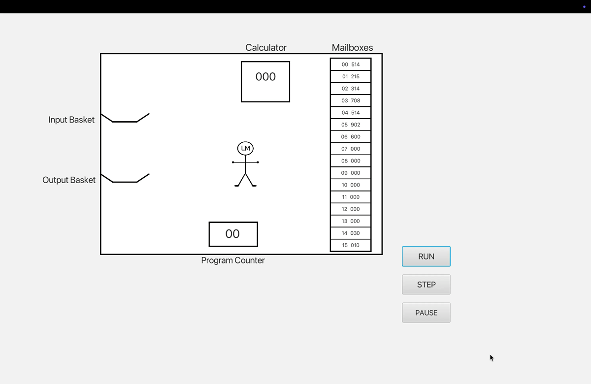

# LMC Animation — JavaFX prototype

My first **Little Man Computer (LMC)** animation project, built while learning Java and JavaFX. A little man carries values between mailboxes, a calculator and input/output baskets to illustrate instruction execution.

**The actively developed browser version is [LMCVisualizer](https://github.com/hanyujason/LMCVisualizer).** This repository preserves the original desktop prototype and its development history. It is a learning prototype rather than a finished classroom simulator.



## Run

Install JDK 21, then use the included Gradle wrapper:

```sh
./gradlew run
```

On Windows:

```powershell
.\gradlew.bat run
```

Gradle downloads the required JavaFX dependencies on the first run. The project uses JavaFX 21.0.6 and Gradle 8.13.

## What the prototype demonstrates

- 16 mailboxes, an accumulator and a program counter.
- Input, output, load, store, addition, subtraction, branching and halt instructions.
- Animated data movement, instruction highlighting, Step, Run and Pause buttons.
- A fixed repeated-subtraction program: start from 30 and subtract 10 until zero.

## Known limitations

- The demonstration program is embedded in the source; there is no program editor or reset control.
- Input is fixed at 123, and output is not retained in a visible output list.
- Instruction scheduling and animation state are coupled; rapid repeated steps can overlap.
- Pause stops automatic scheduling but does not pause the current movement animation.
- The interface uses fixed positions; parts of the character can cross the diagram border.
- The project compiles, but contains no automated test cases. A successful Gradle test task does not establish simulation correctness.
- It is a simplified 16-mailbox demonstration, not a full 100-mailbox LMC implementation.

The browser version rebuilds the simulation core and addresses these limitations through tested execution, an assembler, input/output queues and synchronized animation controls.

## Background

I originally built this independently in JavaFX as a way to understand and explain the LMC model. The browser version continues the same teaching idea with a new implementation and AI-assisted development.

---

这是最初独立编写的 JavaFX 学习原型。它保留小人搬运数据的演示思路，但尚不成熟。后续开发转向 [Web 版](https://github.com/hanyujason/LMCVisualizer)，本仓库用于保存原始实现与开发过程。
